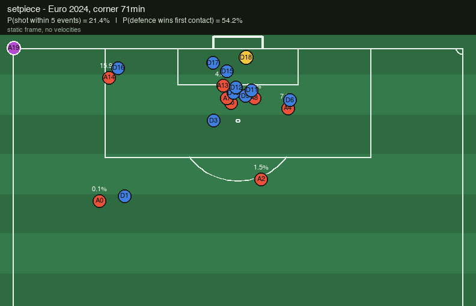
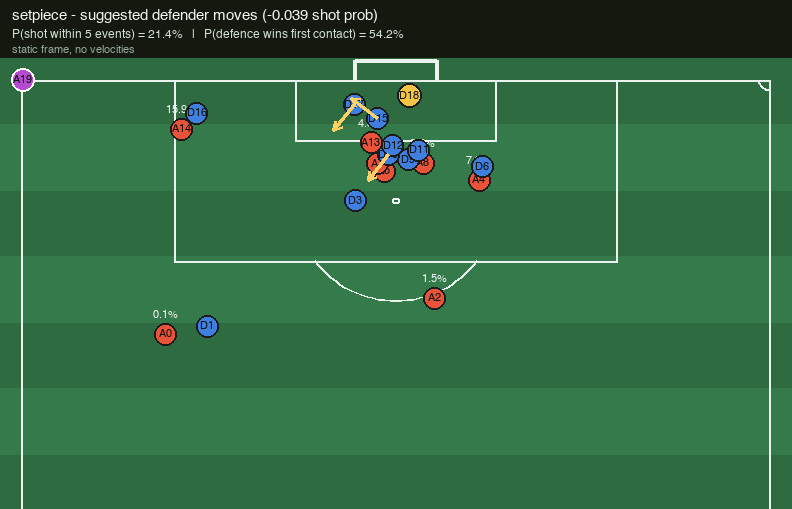

# setpiece

A set-piece coach's tool for corner kicks: it scores who is most likely to win
the first contact on the delivery and how likely a shot is in the next five
events, then searches for small defensive repositionings that lower that shot
probability. The models are graph neural networks over StatsBomb 360 freeze
frames from the public open-data release.

- `setpiece score` — per-player probability of first contact, plus P(shot).
- `setpiece suggest` — ranked defender adjustments, each at most 3 m.
- `setpiece app` — a Streamlit pitch editor: drag a player, re-score on drop.

Everything runs on CPU. Scoring one corner with both heads takes about 10 ms
(measured over the 18 corners in `data/interim/smoke.jsonl`, single-threaded).

---

## Install

The project is managed with [uv](https://docs.astral.sh/uv/).

```
git clone https://github.com/daltonoscar0/setpiece
cd setpiece
uv sync                 # core: torch, torch-geometric, numpy
uv sync --extra app     # adds streamlit + plotly, needed only for `setpiece app`
```

Python 3.11 or 3.12. Trained checkpoints are committed under
`setpiece/assets/`, so scoring works straight after `uv sync` — no download and
no training needed.

## Quickstart

### 1. `demo` — three real Euro 2024 corners, offline

```
uv run setpiece demo
```

It touches no network. Scoring and searching the three corners takes about
0.3 s; the rest is importing torch and loading the checkpoints, which puts a
warm run at roughly 5 s end to end.

One caveat worth knowing: the very first run in a freshly created venv pays a
one-off cost to page torch in from disk. Measured on a clean clone here that
took 46 s, dropping to 7 s on the second run and 5 s thereafter. That is a
property of importing torch, not of the model — inference itself is about
2.5 ms per corner. Abridged output:

```
setpiece demo: three real Euro 2024 corners, scored offline
======================================================================

corner e5c0796a  (UEFA Euro, 2024, match 3930159, 71')
20 players: 9 attacking, 11 defending

 #  role         x     y  P(first contact)
--  -------  -----  ----  ----------------  ----------------
14  attack   100.5  14.5             0.179  ###.............
 8  attack    97.4  36.5             0.100  ##..............
 4  attack    95.9  41.6             0.077  #...............
13  attack    99.3  31.7             0.046  #...............
 7  attack    97.4  32.3             0.035  #...............
 5  attack    96.7  32.9             0.033  #...............
 2  attack    85.2  37.5             0.019  ................
 0  attack    81.9  13.1             0.001  ................
 -  defence                          0.510  ########........

P(shot within 5 events)  0.208  ###.............
actual: first contact attacker (attacker #8), shot within 5: True
positions only; freeze frames carry no velocities (--assume-static)

corner e5c0796a  (UEFA Euro, 2024, match 3930159, 71')
moving up to 2 defenders to lower the shot probability
base P(shot) 0.208

#  P(shot)   delta  moves
-  -------  ------  ------------------------
1    0.194  -0.014  #15 -> 103.3,30.0 (3.0m)
2    0.203  -0.006  #15 -> 99.6,34.7 (3.0m)
3    0.204  -0.004  #15 -> 98.5,32.7 (3.0m)

static repositioning at the moment of the delivery; no player is assumed to cover ground (--assume-static)
----------------------------------------------------------------------
...
scored and searched 3 corners in 1.3s (plus 7.1s to import torch and load the checkpoints), no network access
```

`--format json` and `--format csv` are available on `demo`, `score` and
`suggest`.

### 2. `score` — one corner of your own

Write the shape to a CSV (columns and units are in
[Input formats](#input-formats) below) and score it:

```
uv run setpiece score corner.csv
```

### 3. `suggest` — what to change

```
uv run setpiece suggest corner.csv --movers 2 --top-k 3
```

Flags: `--defend` (the default, minimise P(shot)), `--attack` (maximise it, to
show an attacking coach where the shape breaks), `--movers N`, `--max-move M`
(metres), `--beam N`, `--top-k N`, `--seed N`, `--format`, `--model PATH`.
The search is deterministic: same corner, same seed, same output.

### 4. `app` — the pitch editor

```
uv sync --extra app
uv run setpiece app            # add --headless to stay out of the browser
```

Serves on <http://localhost:8501> (`--port` to change it). Pick one of the
bundled corners or upload a JSON/CSV in the sidebar, drag players on the pitch,
watch the probabilities move, press **suggest defender moves** to overlay the
proposed adjustments, **apply these moves** to commit them, and **download PNG**
to export the annotated pitch. The model cards are in an expander at the bottom.

## Rebuilding the models from scratch

`data/` is gitignored, so a fresh clone has the checkpoints but not the dataset.
To rebuild both:

```
uv run setpiece fetch          # walk StatsBomb open data, extract corners
uv run setpiece train          # 5-fold purged CV, then refit on everything
```

`fetch` walks every open competition-season flagged for 360 data, downloads the
events and freeze frames one match at a time (rate limited to one request per
second, with retries), extracts the corners that carry a frame, and writes JSON
lines to `data/interim/corners.jsonl`. Raw files are discarded after extraction
unless you pass `--keep-raw`. Progress is checkpointed in
`data/interim/corners.state.json` after every tenth match, so an interrupted
build resumes instead of re-downloading. `--competition NAME` (repeatable) and
`--max-matches N` narrow it:

```
$ uv run setpiece fetch --competition "UEFA Euro" --max-matches 1 --out data/interim/sample.jsonl
building dataset: 1 matches to fetch
1/1 matches, 3 corners
3 corners from 1 matches -> data/interim/sample.jsonl
```

The full build is several hundred matches at one request per second, so budget
an hour or so of mostly waiting.

`train` cross-validates both heads and both baselines, prints the metrics table,
writes it to `docs/metrics.md`, and saves `receiver.pt`, `shot.pt` and
`report.json` to `--out-dir` (default `runs/latest`). Useful flags: `--dataset`,
`--out-dir`, `--folds`, `--epochs`, `--hidden`, `--layers`, `--dropout`, `--lr`,
`--weight-decay`, `--batch-size`, `--seed`, `--limit N`, `--quiet`, and
`--no-metrics-file` to print the table without touching `docs/metrics.md`.

Note that `train` writes to `--out-dir`; it does **not** overwrite the bundled
checkpoints in `setpiece/assets/`. Score against a fresh run with
`--model runs/latest`, and copy the two `.pt` files into `setpiece/assets/`
yourself when you want them to become the defaults.

## Input formats

Two things are accepted wherever a command takes `<corner>`:

**StatsBomb 360 JSON.** A `three-sixty` entry (an object with `event_uuid` and
`freeze_frame`), a bare `freeze_frame` list, or a one-element list of either.
`teammate`, `actor` and `keeper` map to attacker, taker and goalkeeper, and the
120x80 StatsBomb coordinates are rescaled to metres at the loader boundary.
`setpiece`'s own serialisation (`{"corner_id": ..., "players": [...]}`) is
accepted too, as is a whole `.jsonl` or `.ndjson` dataset — every corner in the
file is scored.

**Plain CSV.** Columns `team,x,y,is_taker` with an optional `is_keeper`:

| column | meaning |
|---|---|
| `team` | `attack` / `defend` (also `att`/`def`, `a`/`d`, `1`/`0`) |
| `x`, `y` | metres on a 105x68 pitch |
| `is_taker` | `1` for the player taking the corner, else `0` |
| `is_keeper` | `1` for a goalkeeper, else `0` (optional) |

**Coordinates are metres on a 105x68 pitch, the attacking team always attacking
towards +x.** The goal being attacked is centred at `(105, 34)`, its posts at
`y = 30.34` and `y = 37.66`, and the corner flags are at `(105, 0)` and
`(105, 68)`.

Flag exactly one attacker as the taker. If nothing is flagged, the delivery
origin falls back to whichever corner flag is nearest to the shape — a
geometric inference, never an invented player — but the unflagged taker is then
treated as an ordinary attacker and will be scored as a candidate receiver,
which is wrong and obvious in the output.

### A worked example

Save this as `corner.csv` — a delivery from the flag at `(105, 68)`, six
attackers arriving in front of goal plus the taker, ten defenders including the
keeper on his line:

```csv
team,x,y,is_taker,is_keeper
attack,104.8,67.6,1,0
attack,99.5,36.5,0,0
attack,98.2,33.0,0,0
attack,97.0,38.5,0,0
attack,94.5,34.5,0,0
attack,92.0,29.0,0,0
attack,88.0,34.0,0,0
defend,103.6,34.0,0,1
defend,100.0,30.9,0,0
defend,99.8,37.2,0,0
defend,98.5,35.0,0,0
defend,97.6,31.5,0,0
defend,96.0,38.0,0,0
defend,94.0,32.0,0,0
defend,93.5,36.5,0,0
defend,90.0,34.0,0,0
defend,86.0,40.0,0,0
```

```
$ uv run setpiece score corner.csv
corner corner
17 players: 7 attacking, 10 defending

#  role        x     y  P(first contact)
-  -------  ----  ----  ----------------  ----------------
3  attack   97.0  38.5             0.124  ##..............
1  attack   99.5  36.5             0.096  ##..............
2  attack   98.2  33.0             0.072  #...............
4  attack   94.5  34.5             0.067  #...............
5  attack   92.0  29.0             0.027  ................
6  attack   88.0  34.0             0.003  ................
-  defence                         0.612  ##########......

P(shot within 5 events)  0.332  #####...........
positions only; freeze frames carry no velocities (--assume-static)
```

The taker is absent from the table because the taker is never a candidate to
receive their own corner; the probabilities over the listed attackers and the
`defence` row sum to 1. Then:

```
$ uv run setpiece suggest corner.csv --movers 2 --top-k 3
corner corner
moving up to 2 defenders to lower the shot probability
base P(shot) 0.332

#  P(shot)   delta  moves
-  -------  ------  ------------------------------------------------
1    0.268  -0.064  #13 -> 93.6,29.0 (3.0m); #8 -> 101.8,28.5 (3.0m)
2    0.270  -0.062  #13 -> 93.6,29.0 (3.0m); #8 -> 99.6,27.9 (3.0m)
3    0.270  -0.062  #13 -> 91.6,30.1 (3.0m); #8 -> 101.8,28.5 (3.0m)

static repositioning at the moment of the delivery; no player is assumed to cover ground (--assume-static)
```

`--format csv` gives one row per player (plus a `defence_first_contact` row per
corner) and `--format json` gives the full structure, including the input
coordinates and a `assume_static: true` flag.

## What this model knows, and what it does not

Read this before showing a number to a coach.

**Freeze frames are static. There are no velocities anywhere, and none are
invented.** A StatsBomb 360 frame is a single snapshot at the moment the corner
is struck. Nothing in this codebase estimates, interpolates or fabricates a
velocity, so the models cannot know who is already moving, and the suggestion
search has no idea whether a defender could actually cover the ground it
proposes. Every output is annotated `--assume-static` for that reason. A
suggested move is "stand two metres deeper at the moment of the delivery", not
"make this run".

**Frames are anonymous and incomplete.** There are no player identities, only
positions and three flags (teammate, actor, keeper), so the model cannot know
that a particular centre-back is 1.95 m tall or that a particular attacker wins
everything at the near post. Frames are also variable size: only the players
inside the broadcast camera's field of view are captured. Across the 2464
corners in this dataset that is 8 to 22 visible players, median 19, and 2 to 11
attackers, median 8. Someone is often missing.

**Many open-data corners have no frame at all.** Only competition-seasons
flagged `match_available_360` carry freeze frames — on the order of half the
corners in StatsBomb's open data, though nobody here has measured the exact
fraction and `TODO.md` says so — and the catalogue flag itself is not reliable
(African Cup of Nations 2023 is flagged but ships no frames). Even
inside a match that does have 360 data, individual corners can be missing their
frame; in a four-match spot check, 22 of 27 corners had one. Corners without a
frame are skipped entirely, and the models never see them.

**The receiver label is noisy, because it is recovered positionally.** Freeze
frames carry no identities, so there is no direct way to say "player 7 received
it". The loader takes the first genuine touch after the corner and matches its
location to the *nearest attacking node in the frame*. That is an inference, not
a fact: if two attackers are a metre apart the wrong one may be credited, and if
the real receiver was outside the camera view the nearest visible attacker would
be credited instead. Matches further than 8 m from the touch are treated as
ambiguous and **dropped** from receiver training and evaluation rather than
guessed at. Of 2464 corners, 923 carry a clean receiver label.

**The shot label is coarse.** `shot_within_5` is true when the attacking team
shoots within the five events following the corner. It says nothing about shot
quality, and it inherits whatever the event feed decided counts as an event.
The base rate is 0.275.

**The suggestion search is a search over one model's opinion.** It optimises the
shot head, which — see the metrics below — is the weaker of the two heads and
loses to a logistic regression. Treat a `-0.06` delta as "this model prefers
this shape", not as evidence that the shot probability really falls.

## The receiver target

The receiver head is a softmax over the candidate attackers **plus one extra
class: "defence wins first contact"**. Candidates are the attackers in the frame
excluding the taker.

That extra class is not a modelling convenience, it is the most common outcome
in the data. Over 2464 corners the defence makes the first contact 1422 times
against the attack's 1042. A model that could only rank attackers would be
answering the wrong question for the majority of corners, and a coach asking
"who is going to get on the end of this?" needs "probably nobody, it gets
cleared" to be an available answer. It is also why the metrics below report
top-1 and top-3 on the attacker-first subset separately from overall accuracy:
the nearest-to-goal heuristic can only rank attackers, so that subset is the
only place all three models can be compared like for like.

Rows where the attack won the first contact but the positional match was
ambiguous (`receiver_match_dist > 8 m`) are dropped, not relabelled.

## Results

From `docs/metrics.md`, which is written by `setpiece train` and holds measured
numbers, not targets.

Dataset: `data/interim/corners.jsonl`, 2464 corners from 415 matches across
eight competitions (1. Bundesliga, FIFA World Cup, La Liga, Ligue 1, Major
League Soccer, UEFA Euro, UEFA Women's Euro, Women's World Cup), seasons 2020
to 2025.

Split scheme: **purged 5-fold cross-validation grouped by `match_id`**. Every
corner of a match sits in exactly one fold, so no model is scored on a match it
trained on. The numbers are pooled out-of-fold predictions — each corner scored
exactly once — and both baselines are fitted on the same training folds and
scored on the same held-out rows as the GNN. Folds hold 83 matches each; rows
per fold are [493, 493, 493, 493, 492].

### Receiver head

Scored on 2345 corners with a usable receiver label, of which 923 were won by an
attacker. The 119 excluded corners are attacker-first ones whose receiver was off
camera, so dropping them lifts the defence share of the scored rows from 0.577 to
0.606: all three models are compared on identical rows, but the "overall accuracy"
and "defence-wins AUC" columns describe that subset, not corners in general.

| model | top-1 (attacker-first) | top-3 (attacker-first) | overall acc. incl. defence | defence-wins AUC |
|---|---|---|---|---|
| GNN | **0.427** | **0.724** | **0.643** | 0.623 |
| logistic regression | 0.417 | 0.713 | 0.636 | **0.639** |
| nearest-to-goal heuristic | 0.158 | 0.496 | 0.606 | 0.476 |

Random guessing over the candidates scores about 0.149 top-1 and 0.441 top-3
(the top-3 floor is high because a corner with three or fewer candidate
attackers is a free hit for everyone); always predicting "defence wins" scores
0.606 overall.

The GNN beats the nearest-to-goal heuristic on both top-1 (0.427 against 0.158)
and top-3 (0.724 against 0.496). That is the result this project is actually
built on, and it is a wide margin: the heuristic's top-3 is barely above the
0.441 chance floor, and its top-1 is at chance. The GNN also beats the logistic
regression on those two numbers, but only just, and the logistic regression is
better at knowing when the defence will win the ball (AUC 0.639 against 0.623).

Treat the GNN column's third decimal as noise. Torch's parallel reductions sum
in thread-partition order, so re-running `setpiece train` on identical data with
identical seeds but a different intra-op thread count moves the GNN numbers by
about 0.003 while both baselines reproduce exactly. The thread count used is
recorded in each model card as `training.torch_threads`.

### Shot head

Binary `shot_within_5`, scored on all 2464 held-out corners, base rate 0.275.
The heuristic is the training-fold shot rate — a constant within a fold, so it
carries no information about an individual corner and is here as the floor. Its
0.485 sits below 0.5 for a mechanical reason rather than by chance: the
training-fold rate is a strictly decreasing function of the held-out fold's own
rate, so a constant-prior score is mildly anti-correlated with the label by
construction. The gap between 0.485 and 0.5 is not a signal.

| model | AUC |
|---|---|
| GNN | 0.566 |
| logistic regression | **0.593** |
| shot-rate prior | 0.485 |

**The logistic-regression baseline beats the GNN on shot AUC: 0.593 against
0.566.** The message passing buys nothing here, and 0.566 is a weak number in
absolute terms besides. `setpiece suggest` nevertheless optimises the GNN shot
head, because that is the model wired into the search; no comparison of the two
as search objectives has been run. The honest summary is that this tool ranks
receivers well and predicts shots poorly. See `TODO.md`.

Model sizes: receiver 118,082 parameters, shot 113,857.

## Data, licence and attribution

The code in this repository is MIT licensed, as declared in `pyproject.toml`.
There is no `LICENSE` file in the tree yet; it lands with the first release.

The data is not. Everything the models are trained on comes from
[StatsBomb Open Data](https://github.com/statsbomb/open-data), which StatsBomb
publish free of charge under the **StatsBomb Public Data User Agreement**
(`LICENSE.pdf` in that repository). Read that document before you publish
anything derived from the data; do not rely on this paragraph as a summary of
it. The condition it is best known for, and the one that applies to this
repository, is attribution: work made public using the data must credit
StatsBomb as the source and display the StatsBomb logo. Other conditions,
including limits on commercial use, are in the agreement itself.

`setpiece fetch` downloads that data at runtime from StatsBomb's public
repository and caches it under `data/`, which is gitignored. Three Euro 2024
freeze frames are committed in `setpiece/assets/demo/` so that `setpiece demo`
works offline; they are StatsBomb open data too, and the same agreement covers
them and the trained checkpoints in `setpiece/assets/`.

Data provided by StatsBomb.

## Screenshots

Both images below are produced by the app's own PNG export (`render_png`), so
they are exactly what the export button writes — same drawing, same header.

A scored corner. Each attacker carries its probability of winning first
contact; the header shows P(shot within 5 events) and P(defence wins first
contact), with the static-frame caveat:



The same corner after `suggest`, with the three proposed defender moves drawn
as arrows. This one takes P(shot) from 0.214 to 0.175:



The CLI output is shown inline throughout this README and in `docs/usage.md`
rather than as an image, so it stays copy-pasteable and greppable.

## Documentation

- `docs/usage.md` — an end-to-end walkthrough with real commands and output.
- `docs/architecture.md` — the module contract.
- `docs/metrics.md` — the measured numbers, regenerated by `setpiece train`.
- `TODO.md` — known gaps, shortcuts and things that are not finished.
